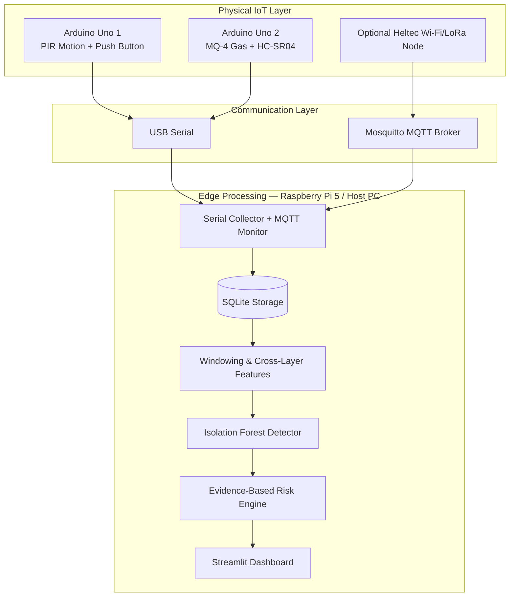
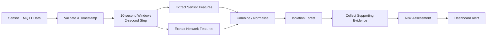

# AI-Based Behavioural Vulnerability Assessment and Risk Prediction for IoT Devices

An open-source **research and engineering framework** for detecting unusual IoT behaviour by correlating physical sensor telemetry with network communication activity. The framework combines Arduino sensor nodes, MQTT monitoring, edge-based machine learning, and evidence-based risk assessment.

[](https://www.python.org/)
[](https://www.arduino.cc/)
[](https://www.raspberrypi.com/)
[](https://mosquitto.org/)
[](https://scikit-learn.org/)
[](https://streamlit.io/)

---

## Overview

Traditional IoT monitoring often examines sensor readings or network traffic independently. Similar observations—such as repeated sensor values—may result from a physical fault, replayed messages, or a compromised device. This project combines both layers to provide more context for anomaly detection and risk interpretation.

The framework is designed for controlled research experiments and reproducible evaluation. It is not a certified safety system or a production-ready intrusion-prevention solution.

## Proposed Solution

The system collects physical sensor telemetry and MQTT communication data, aggregates observations into time windows, and extracts sensor, network, and cross-layer features. An unsupervised **Isolation Forest** detects behavioural deviations from a learned baseline. An evidence-based risk engine then maps observed behaviour to interpretable risk levels, displayed through a Streamlit dashboard.

## Research Questions

- **RQ1 — Cross-layer detection:** Does combining physical and network features improve detection compared with sensor-only or network-only monitoring?
- **RQ2 — Fault and attack differentiation:** Can the system distinguish physical sensor faults, such as stuck or dropped readings, from attack-like network behaviour, such as replay, flooding, and rogue publishers?
- **RQ3 — Explainable risk assessment:** Can an evidence-based risk score provide more transparent and actionable alerts than an anomaly score alone?

## Key Features

- Multi-node Arduino sensor monitoring.
- MQTT message-rate, timing, payload, and publisher-behaviour monitoring.
- Cross-layer feature extraction using sliding time windows.
- Unsupervised Isolation Forest anomaly detection.
- Evidence-based risk scoring and alert interpretation.
- Streamlit dashboard for monitoring and visualisation.
- Controlled fault and attack-like scenario evaluation.

## Tools & Technologies

| Tool / Technology | Purpose |
|---|---|
| **Python** | Data collection, processing, risk engine, and experiments |
| **NumPy & Pandas** | Numerical operations and feature processing |
| **scikit-learn** | Isolation Forest and evaluation metrics |
| **Arduino C++ / Arduino IDE** | Firmware for sensor nodes |
| **Mosquitto & Paho MQTT** | MQTT broker and communication monitoring |
| **pySerial** | USB-serial communication with Arduino |
| **SQLite** | Local telemetry and experiment storage |
| **Streamlit & Plotly** | Dashboard and visualisations |

---

## System Architecture

The framework is organised into physical sensing, communication, edge processing, and visualisation components.



### Architecture Overview

1. **Physical layer:** Arduino nodes collect motion, button, gas-sensor, and distance readings.
2. **Communication layer:** Arduino telemetry is sent over USB serial. An optional wireless endpoint can publish telemetry through MQTT.
3. **Collection and storage:** Python collectors timestamp and record serial and MQTT observations in the local data store.
4. **Feature extraction:** The pipeline aggregates observations into time windows and computes physical, network, and cross-layer features.
5. **Detection and risk:** Isolation Forest scores behavioural deviations; the risk engine combines detector output with observable evidence.
6. **Visualisation:** The dashboard displays telemetry, network activity, anomaly indicators, and risk alerts.

### Data Processing Pipeline



The 10-second window with a 2-second step allows successive feature windows to overlap, preserving short-term behavioural changes for analysis.

## Feature Groups

| Feature group | Examples |
|---|---|
| **Physical sensor features** | MQ-4 mean and variance, mean distance, motion-event count, sensor read-error and dropout indicators |
| **Network features** | MQTT message rate, payload size, inter-arrival-time jitter, duplicate/replay count, unexpected publisher indicator |
| **Cross-layer features** | Sensor update rate compared with message rate; repeated readings during unusual traffic; missing sensor updates associated with communication changes |

Repeated values alone do not prove an attack. The system considers their timing and relationship with other physical and network observations.

---

## Proposed Risk Scoring

The research paper proposes a likelihood-and-consequence risk matrix:

\[
\boxed{R=L\times C}
\]

- \(R\): Composite risk score.
- \(L\): Runtime anomaly likelihood level, from 1 (low) to 3 (high).
- \(C\): Asset consequence weight, from 1 (low) to 3 (high).

### Anomaly likelihood levels

| Likelihood | Isolation Forest anomaly score \(A\) |
|---|---:|
| Low (\(L=1\)) | \(A < 0.50\) |
| Medium (\(L=2\)) | \(0.50 \leq A < 0.75\) |
| High (\(L=3\)) | \(A \geq 0.75\) |

### Risk scoring matrix (\(R=L\times C\))

| Likelihood | Low impact (\(C=1\)) | Medium impact (\(C=2\)) | High impact (\(C=3\)) |
|---|---:|---:|---:|
| **High (\(L=3\))** | 3 — Medium | 6 — High | **9 — Critical** |
| **Medium (\(L=2\))** | 2 — Low | 4 — Medium | 6 — High |
| **Low (\(L=1\))** | 1 — Low | 2 — Low | 3 — Medium |

Asset consequence weights in the paper: PIR motion/access sensor = 1; distance/proximity sensor = 2; MQ-4 gas sensor or safety-related relay = 3.

In the reported experiment, when a critical risk score (\(R=9\)) was triggered, the action dispatcher issued Mosquitto client disconnection commands within **45 ms**. This is a reported test result, not a guaranteed response time for every deployment.

---

## Hardware Requirements

| Component | Quantity | Purpose |
|---|---:|---|
| Raspberry Pi 5 (4 GB) or compatible host PC | 1 | Runs data collection, storage, feature extraction, ML, risk engine, and dashboard |
| Arduino Uno R3 | 2 | Physical sensor data acquisition |
| PIR motion sensor | 1 | Motion/event detection |
| Push button | 1 | Manual event input |
| MQ-4 gas sensor module | 1 | Relative gas-sensor readings for experiments |
| HC-SR04 ultrasonic sensor | 1 | Distance/proximity measurements |
| USB cables | 2 | Connect Arduino boards to the gateway |
| Breadboard and jumper wires | As required | Circuit connections |
| Heltec Wi-Fi/LoRa board | Optional | Wireless MQTT telemetry experiments |

**Safety note:** The MQ-4 module is uncalibrated in this setup and is used for relative anomaly experiments only. It is not a certified gas detector and must not be relied upon for life-safety monitoring.

## Hardware Connections

### Arduino Uno 1 — Event Node

| Component | Arduino pin |
|---|---|
| PIR OUT | D8 |
| Push button | D2 and GND (using `INPUT_PULLUP`) |
| PIR VCC / GND | As specified by the module / GND |

### Arduino Uno 2 — Environmental Node

| Component | Arduino pin |
|---|---|
| MQ-4 Analog Output | A0 |
| HC-SR04 Trigger | D3 |
| HC-SR04 Echo | D4 |
| Sensor power and ground | Follow module specifications; connect grounds appropriately |

**Electrical note:** HC-SR04 Echo is typically a 5V signal. Use a suitable level shifter or voltage divider when connecting it to a 3.3V-only input. Check the specifications of each module before wiring.

---

## Repository Modules

```text
arduino/       Arduino firmware for the sensor nodes
pi/            collector.py, mqtt_monitor.py, features.py,
               detector.py, risk.py, dashboard.py
experiments/   generate_test_data.py, evaluate.py
data/          Local telemetry and experiment outputs
```

## Experimental Results

The paper reports **6,000 windowed feature samples** across six controlled scenarios: normal baseline, stuck sensor, dropped readings, replay attack, message flooding, and rogue publisher.

### Detection performance

| Monitoring approach | Precision | Recall | F1-score | False-positive rate |
|---|---:|---:|---:|---:|
| Sensor-only | 74.5% | 66.4% | 70.2% | 11.8% |
| Network-only | 84.2% | 78.8% | 81.4% | 6.4% |
| **Cross-layer (proposed)** | **92.8%** | **88.5%** | **90.6%** | **3.1%** |

### Per-scenario F1-score

| Scenario | Category | F1-score |
|---|---|---:|
| Normal baseline | Normal | 97.1% |
| Stuck sensor | Hardware fault | 92.6% |
| Dropped readings | Hardware fault | 90.2% |
| Replay attack | Cyberattack scenario | 89.1% |
| Message flooding | Cyberattack scenario | 98.1% |
| Rogue publisher | Cyberattack scenario | 90.3% |
| Macro average | — | 92.9% |

### Edge performance reported in the paper

| Metric | Reported result |
|---|---:|
| Average processing time per window | 14.2 ms |
| Raspberry Pi 5 CPU usage | Under 4% |
| RAM usage | 45 MB |
| Critical-risk MQTT disconnection command | Within 45 ms |

These results apply to the reported hardware setup and controlled, scripted scenarios. They do not establish generalisation to all IoT devices, attacks, or long-term deployments.

## Limitations & Future Work

- Arduino Uno has limited memory, so feature extraction and ML inference run on the gateway.
- The experiments use controlled scenarios and do not cover every real-world attack or changing deployment condition.
- MQTT client IDs alone are not cryptographic identity verification.
- The MQ-4 sensor is uncalibrated and is not suitable as a certified safety instrument.
- Future work includes longer physical deployments, authenticated MQTT, adaptive baselines, TinyML, and federated learning.

## Authors

**Nimra Wani and Milad Ajaz Bhat**  
Central University of Kashmir, Ganderbal, Jammu and Kashmir, India


